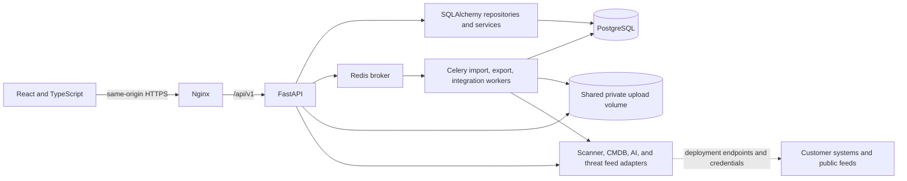

# SAM security exposure platform

SAM is being rebuilt as a full-stack application. The browser client is React, TypeScript and Vite; the API is FastAPI; persistence is SQLAlchemy with Alembic; imports and exports use Celery and Redis. PostgreSQL is the deployment database. The previous inline HTML application is not served by the backend.

## Current implementation status

The repository contains the React client, authenticated/versioned API, relational schema and migrations, account/session controls, asset and finding workflows, risk/compliance/exposure views, CISA KEV and FIRST EPSS ingestion, audit chain, governance and containment approval records, CSV/XLSX import/export jobs, and Docker Compose deployment files. Qualys VMDR and ServiceNow CMDB adapters use configured endpoints and asynchronous read-only sync jobs. Passive external-domain discovery uses explicitly authorized targets and SSLMate Cert Spotter certificate-transparency data; discoveries remain candidates until an administrator verifies and promotes them to inventory. ServiceNow incident creation is separately disabled by default and requires a dedicated writer account, explicit configuration, analyst action, persisted idempotency, and provider confirmation. Containment approvals are recorded in SAM and do not isolate customer infrastructure until an external provider adapter is implemented and configured.

This is an active engineering transformation, not a production certification. See [the engineering audit](docs/ENGINEERING_AUDIT.md) for implemented scope, verification evidence, and outstanding work. PostgreSQL, Redis, Docker, and browser end-to-end verification must be run in an environment that provides those services before production acceptance.

## Run locally

For step-by-step client workstation instructions (GitHub clone or ZIP, Docker setup, local secrets, startup, login, logs, and shutdown), see [Client local setup](docs/CLIENT_LOCAL_SETUP.md).

Python 3.12+ and Node.js 22+ are required. To run against PostgreSQL and Redis, copy `.env.example` to `.env`, replace every placeholder with unique random values, and start the stack:

```sh
cp .env.example .env
# Edit .env. Use URL-safe random secrets; never commit .env.
docker compose up --build
```

The web client is at `http://localhost:8080`; the API is proxied under `/api/v1`. Production mode requires TLS in front of the web container because refresh cookies are Secure. The API does not create or reset database tables at startup: the one-shot `migrate` service applies Alembic revisions before the API and worker start.

For local feature QA without Docker, first run `uv sync --locked --extra dev` and `npm --prefix frontend ci`, then start the app with `./scripts/run-local-qa.sh`. With Node.js and frontend dependencies available, open `http://127.0.0.1:5173`; otherwise the launcher serves the last production build through FastAPI at `http://127.0.0.1:8000`. The script migrates an ignored local SQLite database and runs actual Celery task functions inline for local imports/exports. Use the separate Docker Compose stack for PostgreSQL/Redis worker QA.

For frontend iteration, run the API, Postgres, and Redis services, then run Vite separately:

```sh
npm --prefix frontend install
npm --prefix frontend run dev
```

For a local backend-only run, set `APP_ENV=development`, configure a non-production `DATABASE_URL`, apply migrations, and start Uvicorn:

```sh
uv sync --extra dev
uv run alembic -c alembic.ini upgrade head
uv run uvicorn backend.main:app --reload --host 127.0.0.1 --port 8000
```

For a single-process local QA session without Redis, set `CELERY_TASK_ALWAYS_EAGER=true` while `APP_ENV=development`; this runs the actual Celery task functions inline so CSV/XLSX import and export flows can be exercised. Keep this setting disabled in shared QA and production, where tasks must run through the Redis-backed worker service.

The API docs are at `/api/v1/docs` outside production. Sample data is never loaded unless `LOAD_SAMPLE_DATA=true` is explicitly set in a development/QA environment. For the QA fixture account, set `SAM_ADMIN_EMAIL` and `SAM_ADMIN_PASSWORD` yourself; no default login is provisioned.

## Verify changes

```sh
uv sync --locked --extra dev
uv run pytest backend/tests -q
uv run ruff check backend
uv run ruff format --check backend
npm --prefix frontend ci
npm --prefix frontend run typecheck
npm --prefix frontend run lint
npm --prefix frontend test
npm --prefix frontend run build
npx --prefix frontend playwright install chromium
npm --prefix frontend run test:e2e
```

Backend and Playwright QA tests use fresh SQLite databases and run the real Alembic migrations; the browser test starts the API and Vite itself. Deployment uses PostgreSQL. CI runs backend, frontend, browser E2E, and container-build checks. PostgreSQL runtime behavior remains a separate QA gate.

## Architecture



## Repository map

- `frontend/src/` — routed React pages, auth-aware API client, components, and styles.
- `frontend/e2e/` — Playwright browser journeys against a fresh QA backend and Vite process.
- `backend/api/` — versioned HTTP routes and request validation.
- `backend/schemas/` — API request and response contracts.
- `backend/services/` — business operations and file parsing.
- `backend/repositories/` — SQLAlchemy query and persistence operations.
- `backend/db/` — ORM models and shared declarative base.
- `backend/core/` — settings, database sessions, authentication, logging, and cross-cutting controls.
- `backend/integrations/` — external connector and notification adapters.
- `backend/workers/` — Celery app and asynchronous task handlers.
- `backend/migrations/versions/` — reviewed, versioned schema changes.
- `backend/tests/` — backend API/security/import tests.
- `docs/` and `scripts/` — audit, QA/deployment procedures, backup, and restore.

## Important operating limits

- Scanner/CMDB synchronization requires approved Qualys and ServiceNow endpoints, credentials, tenant-specific mapping, Redis and worker services, and customer validation. ServiceNow ticket writeback separately requires `SERVICENOW_TICKET_WRITE_ENABLED=true` and dedicated ticket writer credentials. Connection tests, sync history, and ticket references are stored in SAM; success is recorded only after ServiceNow returns a real incident reference.
- Containment approval is only a SAM governance record until an independently secured endpoint/cloud/network adapter is configured and tested. It does not shut down or quarantine a server by itself.
- Recorded compliance and WAF posture are not policy attestations or independent WAF verification.
- CISA KEV and FIRST EPSS snapshots are stored and matched to open findings and impacted assets. A daily Celery Beat job runs at 02:15 UTC; administrators can also request a manual sync. EPSS is an exploitation-likelihood signal, not a complete risk score. Public-feed access still depends on the deployed API/worker having HTTPS egress.
- External discovery requires a Cert Spotter API token on both API and worker. SAM queries only certificate-transparency records for domains an administrator attests they are authorized to monitor; it does not probe returned hosts. Configure `CERTSPOTTER_API_TOKEN` and the bounded `EXTERNAL_DISCOVERY_MAX_PAGES` setting. Provider tenant access has not yet been validated.
- The analyst API uses SAM records. Without provider configuration it clearly operates in limited rule-based QA mode. An optional OpenAI Responses API adapter is disabled by default and only sends the user's question, up to four prior chat turns, bounded asset summaries, and prioritized finding metadata when `AI_ANALYST_ENABLED=true`, `AI_ANALYST_DATA_APPROVED=true`, and a server-side API key and model are configured. Raw finding evidence and credentials are excluded; customer approval, provider policy review, and tenant QA remain required.
- Configure external TLS termination, secret management, persistent encrypted volumes, monitoring, log retention, backup storage, and recovery objectives for the customer environment.

See [operations and recovery](docs/OPERATIONS.md) for environment, deployment, backup, restore, and rollback procedures.
