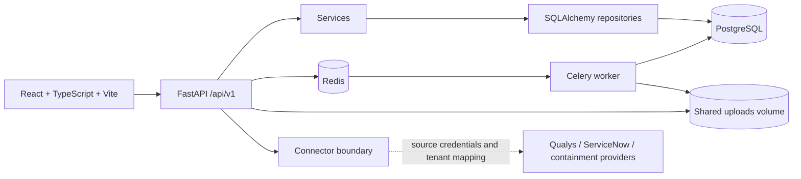

# SAM engineering audit and implementation plan

Audit date: 2026-11-24. This report tracks the source currently in this repository. It is a work-in-progress assessment, not a production-readiness certification.

## Audit findings before transformation

- The previous frontend combined its interface, routing, dashboard calculations, fixture fallbacks, analyst guidance, and simulated actions inside an HTML page with large inline CSS/JavaScript blocks.
- Some browser operations reported success from local state without durable server confirmation. Browser storage was used for authentication state.
- FastAPI endpoints existed, but a number of routes owned SQL and calculations directly. PostgreSQL deployment, schema evolution, asynchronous import/export, and production runbooks were absent or incomplete.
- Security controls were inconsistent: legacy password hashing and token lifecycle, account lockout, audit-chain integrity, upload validation, API-wide error contracts, and rate limiting needed engineering work.
- Scanner, CMDB, mail, WAF, and infrastructure containment systems had no validated customer-configured connector. Their behavior must not be represented as connected until real requests succeed.
- Local start failures were caused by server processes/ports during previous QA work; a repeatable local QA launcher is now provided alongside the Compose deployment.

## Current architecture in code

## Implemented in this worktree

- React/Vite application shell, routed login/password-reset and feature pages, strict TypeScript compiler options, centralized fetch client, refresh-cookie/CSRF handling, loading/error states, and light responsive styling.
- FastAPI app composition, versioned `/api/v1` routes plus temporary `/api` compatibility routes, request IDs, JSON logs, consistent error envelopes, security headers, liveness/readiness routes, and production startup assertions.
- SQLAlchemy engine/session factory, relational ORM tables, repositories/services across production API features, and nine Alembic revisions. Application startup checks that the database is at the current Alembic head; it does not create or upgrade schema. Production API routes, startup bootstrap, and QA seeding use SQLAlchemy rather than a DB-API compatibility adapter.
- Argon2id password hashing with legacy PBKDF2 verification/rehash, short-lived JWT access sessions with revocation, rotating one-time refresh sessions in HttpOnly cookies, CSRF token check, persisted login lockout, password reset token storage and session invalidation, and role checks on sensitive routes.
- Admin-only account management UI and APIs now list paginated users, create accounts idempotently, deactivate/reactivate access, and change roles. Deactivation and role changes revoke access and refresh sessions; self-deactivation and self-role changes are refused, and sensitive changes write tamper-evident audit events. Server-side role checks protect the endpoints.
- Hash-linked audit events with a persisted chain head, transaction-scoped chain locking, and service-backed audit verification.
- Queue-backed import/export jobs, CSV/XLSX parsing limits, configurable mapping, row validation, duplicate detection, row-error reports, formula-safe CSV exports, per-user/admin job access, and shared API/worker files in Docker Compose.
- Asset-import retries preserve their staged input on transient I/O failures and replay rows committed by the same job idempotently, avoiding duplicate assets/audit events after a worker interruption.
- Dockerfiles, PostgreSQL/Redis Compose services, migration one-shot service, API/worker readiness probes, non-root API container, environment example, CI workflow scaffolding, backup/restore scripts, and operational documentation.
- `scripts/run-local-qa.sh` starts the migrated SQLite QA API and Vite client together, checks readiness, prints local QA credentials, and runs actual background task code inline only in a local development mode.
- Configurable Qualys VMDR and ServiceNow CMDB read adapters with connection checks, bounded pagination, authentication, retry handling, field normalization, stable-ID upserts, Celery sync execution, and persisted run history. A separate opt-in ServiceNow incident writer now records idempotency and correlation state, checks for existing incidents before a single POST, stores external references, and reconciles uncertain outcomes. External containment still requires a configured infrastructure provider and never claims execution until one confirms it.
- Authorized passive external-domain discovery through the SSLMate Cert Spotter CT API, with strict provider origin, token-based auth, bounded response sizes/timeouts/pages, pagination, root-domain scoping, persisted authorization attestations, scheduled worker runs, unique active-run protection, durable run status, audit events, and analyst-reviewed hostname candidates. Only accepted candidates become external-facing website inventory records; no active host probing is performed. The integration requires a configured Cert Spotter token and customer authorization.
- Optional OpenAI Responses API analyst adapter, disabled unless both provider enablement and SAM data-sharing approval are explicit. It sends the current question, up to four prior chat turns, bounded inventory summaries, and prioritized finding metadata; excludes raw finding evidence and provider credentials; checks provider completion state; and labels rule-based fallback answers if the provider is unavailable. Provider credentialing, data-policy approval, and tenant QA remain outstanding.
- Approval-controlled containment now exposes a role-protected, read-only impact preview from current asset and dependency records before the requester confirms quarantine or release. The preview distinguishes the expected effect and recorded facts from unrecorded service/customer impact; a change in asset or action clears the acknowledgement. The request still waits for an independent approval and a configured provider before any external action.
- Governance now has a first-class request and approval page instead of a read-only JSON view. It supports asset/finding-scoped time-bounded exceptions, reason validation, reviewer notes, status filters, pagination, and independent approvals; API role and self-review rules remain authoritative. Exception and containment review decisions also replay safely by idempotency key.
- Asset and finding create/update/state APIs, account creation/status changes, exception/workflow/containment actions, and import/export jobs now store and replay successful results for scoped idempotency keys; mismatched bodies return `409`, and regression tests confirm replay does not duplicate operations. The React mutation helpers retain keys across auth-refresh retry. A daily Celery retention task bounds stored idempotency responses and clears abandoned local-operation claims while preserving recent work and separate audit history. Generic asset edits cannot claim provider-confirmed quarantine.
- CISA KEV and FIRST EPSS adapters with HTTPS-only bounded reads, feed schema/count validation, CVE normalization, EPSS score validation, persisted latest snapshots, impact joins, risk-score enrichment, an administrator-triggered sync, and a daily Celery Beat schedule. The worker has a separate outbound egress network while the database and Redis stay on the internal data network. Finding-to-CVE references are normalized in `finding_cves`, including migration backfill from stored Qualys evidence, so every CVE on a scanner detection can be correlated to the affected asset.
- Test suite that applies Alembic migrations to isolated temporary SQLite databases and covers authentication, role enforcement, pagination/order, API versioning, audit chain, risk and compliance summaries, containment approval safeguards, imports, and exports.
- Playwright browser tests that start an isolated migrated SQLite API and Vite frontend, sign in, create/reload an asset, submit a durable rescan workflow, preview containment impact and dependent assets, submit a containment approval request, update a finding, complete an exception request/review using separate requester and approver accounts, process CSV imports and exports, download row-error reports, verify analyst rescan guidance, exercise password-reset validation/error handling, and create/deactivate/reactivate a user account as an administrator. Local E2E invokes the real Celery task functions inline only under the development/test guard; customer environments use the Redis worker. CI installs the pinned Chromium runtime and runs these journeys.
- Explicit Pydantic response contracts now cover governance, import/export job, dashboard/risk, compliance, exposure, attack-path, zero-day signal, executive report, and health endpoints. The risk-priority contract also exposed and fixed a raw-JSON evidence serialization bug; the signal contract reflects categorical confidence labels.
- Import-job and governance list endpoints now filter both returned rows and pagination totals to the requesting user; admin, security-admin, and auditor roles retain oversight views. Regression tests verify an analyst cannot list another user's job, exception, workflow, or containment request.

## Important remaining gaps

- Qualys VMDR, ServiceNow CMDB, and ServiceNow ticket adapters have not been run against a real provider tenant. Real credentials, writer ACLs, custom mandatory incident fields, table mappings, source-specific status values, and sandbox parity remain customer dependencies. Sync currently upserts data and does not retire SAM assets that disappear from a source.
- No real WAF discovery, enterprise SSO/MFA, or endpoint/cloud isolation or recovery connector has been configured. External asset discovery is passive CT hostname discovery only; it does not establish current DNS resolution, ownership, liveness, WAF protection, or vulnerabilities, and the SSLMate tenant/token path has not been verified against a customer account. KEV/EPSS live feed access and a persisted local sync are verified; deployed daily schedules still need a Docker/Redis/Celery environment to verify. The ServiceNow ticket adapter is implemented but awaits customer writer credentials, mandatory-field mapping, and provider QA. The AI analyst adapter has not been tested against a real provider and remains disabled until tenant approval/configuration. Existing data-derived views must be described as SAM-recorded state.
- Rate limits are backed by Redis only in production mode; multi-instance QA should also use shared Redis storage. Tenant/workspace isolation, fine-grained field authorization, and policy review are not implemented.
- PostgreSQL-native tests, concurrency/race tests, background worker integration tests against Redis, and a real Docker Compose run remain unverified because Docker, PostgreSQL, and Redis are not available in the local workspace. Local Playwright exercises the actual Celery task functions in explicit development-only eager mode; the Redis-backed worker path still requires infrastructure verification.
- The schema has integrity constraints and migrations but several timestamps and structured evidence/payload values still use text fields; normalization/JSONB, retention, tenant keys, backfills for other legacy fields, and query/index review need a product-data design review.
- Durable request replay is enforced for asset and finding creation/update, account creation/status/role changes, exception request/review, workflow, containment request/review, and import/export creation; ServiceNow ticket writes retain their provider-specific correlation protocol. Scanner syncs are protected against duplicate active runs by a database constraint, but do not yet replay the same run response. Login, refresh, and password-reset mutations use token/session single-use protections rather than the general replay store. Audit entries are hash-linked but do not yet have an independently protected signing key or external immutable log sink.
- Backup/restore and rollback procedures are written but have not been exercised on a real PostgreSQL deployment. Uploaded files need production-grade encrypted object storage and restore coordination.
- Production deployment still requires a TLS ingress, managed secrets, monitoring/SIEM, identity/email configuration, customer-specific threat model, retention policy, and a reviewed capacity plan.

## Execution plan from this audit

1. Keep source changes small and feature-scoped; preserve current product paths and documented business behavior.
2. Pydantic response schemas are applied to the JSON feature APIs and health endpoints. Continue reviewing SQLAlchemy repository/service boundaries and error-envelope OpenAPI documentation.
3. Apply tenant policy consistently; implement idempotency for high-impact writes, durable retry/status handling, and shared rate limiting in every multi-instance environment.
4. Validate the Qualys and ServiceNow read/write adapters against customer sandbox tenants, confirm mappings and stale-record policy, and keep each capability unconfigured until real connection validation succeeds.
5. Expand Playwright coverage for remaining failure recovery; then run browser journeys against PostgreSQL and Redis workers in a Docker-capable QA environment.
6. Run PostgreSQL/Redis/worker migrations and integration tests in CI and a Docker-capable QA environment. Verify backup, restore, and rollback using a recoverable test dataset.
7. Review schema normalization, indexes, data retention, log content, tenancy, upload object storage, deployment secrets, capacity, and customer threat model before production sign-off.

## Evidence captured so far

- Python 3.12.16 and Node.js 22.23.5 were provisioned into temporary/ignored environments. Python dependencies are pinned in `uv.lock`; browser dependencies are pinned in `frontend/package-lock.json`. Lock validation and `uv sync --locked --extra dev` pass with uv 0.13.9.
- Current backend QA suite: `59 passed` on Python 3.12.16 using Alembic migrations and isolated temporary SQLite databases. Ruff, formatting, and MyPy pass across 114 Python files. Coverage includes typed OpenAPI/runtime response validation for key feature APIs, containment impact preview and dependent-asset reporting, per-user job/governance list isolation, replay-safe mutation/retention and independent-review behavior without duplicate audit events, import worker recovery after a committed batch, normalized multi-CVE finding persistence/correlation, replay-safe governance, account, import, export and external-discovery operations, account session revocation, database-enforced active-sync uniqueness, authentication, RBAC, threat-feed persistence, integrations, and rejection of inline Celery execution outside local development/test modes. Discovery provider behavior is tested with recorded fixtures, not a Cert Spotter account. This does not prove PostgreSQL runtime behavior or Celery scheduling/worker execution against Redis.
- Current frontend checks pass strict TypeScript, ESLint 10.15, ten Vitest tests, and Vite production build. Calls through the shared POST, PATCH, and upload helpers carry idempotency keys that are reused for the client's auth-refresh retry. Rollup reports two non-blocking annotation placement warnings from Zod.
- Playwright `1.65.1` browser E2E passes locally against fresh migrations and a real FastAPI/Vite process pair using Chromium 159.0.8154.6 (`6 passed`, rerun 2026-11-24). It verifies authentication, asset persistence, workflow creation, containment impact preview and request persistence, finding state persistence, an independent exception approval, real CSV import/export task execution and downloads, row-level error reporting, analyst rescan guidance, reset-link validation/error handling, administrator account creation/deactivation/reactivation/role change, and authorized-domain registration with explicit provider-unconfigured status. Browser tests use isolated SQLite and explicit local eager task execution; PostgreSQL E2E and Redis-backed worker execution remain outstanding.
- The latest `npm install` audit reported zero known vulnerabilities for the updated frontend lockfile, and the recorded `pip-audit` run reported zero known backend findings. A follow-up standalone `npm audit --audit-level=moderate` could not reach `registry.npmjs.org` because DNS/network egress was unavailable; repeat the online audit in CI before release.
- PostgreSQL offline Alembic SQL generation was previously checked through `9f4c8b2a6d11`. The current SQLite QA and test databases migrate through `a4d8c2e79105`, which adds passive external discovery targets, runs, candidates, and active-run uniqueness. No PostgreSQL server is present to execute the latest migration.
- A live read-only connection check to CISA KEV and FIRST EPSS succeeded. A local persisted threat-feed sync then read 1,793 upstream feed rows and recorded 1,794 CVE snapshots (CISA KEV plus SAM's distinct CVE set). The migrated local QA DB has four findings and four normalized CVE links.
- `scripts/run-local-qa.sh` previously passed end-to-end against the earlier migration head. The new discovery migration and routes were exercised by the Playwright API/frontend processes against fresh SQLite migrations; all 6 E2E journeys passed. To start the current local QA service, run the launcher from the repository root. The current frontend passes strict TypeScript, lint, all 10 Vitest tests, and a production build; Rollup emits two non-blocking annotation warnings from Zod.
- Docker, PostgreSQL, and Redis are unavailable locally. Compose image builds, PostgreSQL-native behavior, real Celery execution, backup/restore, and associated service health checks remain unverified.
